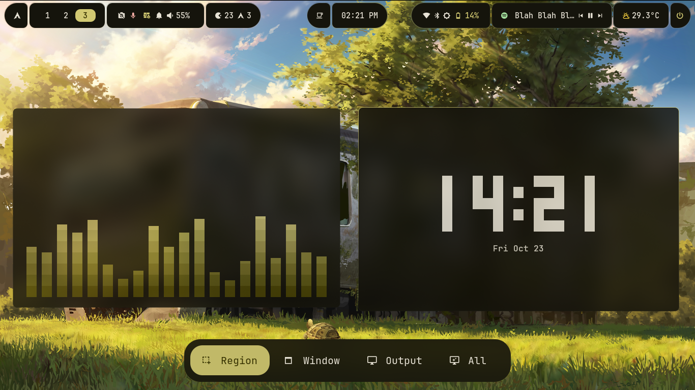

<div align="center">



<br>
<br>

<h1>BlackNode</h1>

<h3>It doesn't come with a theme.<br>It comes with <i>yours</i>.</h3>

<p>A complete desktop that rebuilds itself around the image you love.</p>

<a href="https://github.com/zhaleff/BlackNode/stargazers"></a>&nbsp;
<a href="https://github.com/zhaleff/BlackNode/forks"></a>&nbsp;
<a href="https://github.com/zhaleff/BlackNode/commits/main"></a>&nbsp;
<a href="https://github.com/zhaleff/BlackNode/blob/main/LICENSE"></a>

<br>

&nbsp;
&nbsp;


<br>
<br>

<a href="#gallery"><kbd> <br> Gallery <br> </kbd></a>&ensp;
<a href="#why-blacknode"><kbd> <br> Why BlackNode <br> </kbd></a>&ensp;
<a href="#install"><kbd> <br> Install <br> </kbd></a>&ensp;
<a href="#questions"><kbd> <br> Questions <br> </kbd></a>

</div>

---

> **You already spend most of your life in front of this screen.**
> Why does it still look like everyone else's?

BlackNode is not another preset you install and forget. It is a full desktop that **learns its colors from your wallpaper**: the bar, the terminal, the notifications, the lock screen, the editor, the menus. Change the image, and the entire desk changes with it.

No theme menu. No palette hunting. No restart ritual.

**Pick a picture. The desktop follows.**

---

## Gallery

<div align="center">


<sub><b>The moment it clicks:</b> choose an image, watch the desktop repaint around it.</sub>

<br>
<br>

<table>
  <tr>
    <td width="50%" align="center"></td>
    <td width="50%" align="center"></td>
  </tr>
  <tr>
    <td align="center"><sub>Everything you reach for, one menu away.</sub></td>
    <td align="center"><sub>Your apps, without breaking your flow.</sub></td>
  </tr>
  <tr>
    <td colspan="2" align="center"></td>
  </tr>
  <tr>
    <td colspan="2" align="center"><sub>The same colors, from the music bars to the code.</sub></td>
  </tr>
</table>

<br>

<table>
  <tr>
    <td width="50%" align="center"></td>
    <td width="50%" align="center"></td>
  </tr>
  <tr>
    <td align="center"><sub>Even the details belong.</sub></td>
    <td align="center"><sub>Nothing feels bolted on.</sub></td>
  </tr>
  <tr>
    <td width="50%" align="center"></td>
    <td width="50%" align="center"></td>
  </tr>
  <tr>
    <td align="center"><sub>Capture a moment in two keystrokes.</sub></td>
    <td align="center"><sub>Leave cleanly, when the day is done.</sub></td>
  </tr>
</table>

</div>

---

## Why BlackNode

<table>
  <tr>
    <td width="33%" valign="top">
      <h3>It feels like yours</h3>
      <p>Your wallpaper is not decoration. It is the source of the whole palette. The desk looks like a place you chose, not a place you ended up.</p>
    </td>
    <td width="33%" valign="top">
      <h3>It disappears</h3>
      <p>One modifier, one motion language, a menu for everything else. You stop managing windows and start finishing work.</p>
    </td>
    <td width="33%" valign="top">
      <h3>It stays consistent</h3>
      <p>Bar, terminal, notifications, lock screen, editor, and menus share one visual language. No mismatched corners. No visual noise.</p>
    </td>
  </tr>
</table>

### The difference is not subtle

| The usual desktop | BlackNode |
|---|---|
| You adapt to the defaults | The desktop adapts to **you** |
| Five apps, five personalities | One palette, everywhere |
| A theme installed once, then stale | A desktop that changes when you do |
| Customization becomes a hobby | Customization becomes a single choice |
| You notice your tools | You notice your work |

### Built for the way you actually use a computer

- **One image sets the tone.** Not a color picker. Not a config file. A picture you already love.
- **Your hands stay on the keys.** Focus, move, resize, switch, launch, capture. No reaching.
- **The day has an end.** Brightness fades, the screen locks, the machine sleeps. You do not have to remember.
- **Everything is reversible.** Your old setup is backed up before anything changes.

> If your desk is the place you think, why let it look like a stock photo?

---

## Install

> [!TIP]
> **Ten minutes now. A desk that fits you every day after.**

BlackNode is built for **Arch Linux** with **Hyprland**. One command starts the installer; it checks your system, installs what is missing, backs up what it replaces, and asks before touching anything.

```bash
git clone https://github.com/zhaleff/BlackNode.git "$HOME/BlackNode"
cd "$HOME/BlackNode"
bash Scripts/install.sh
```

> [!IMPORTANT]
> The installer replaces your GTK, Qt, shell, and Zsh configuration. Your current files are copied to a timestamped backup first, and every action is logged to `~/.blacknode-install.log`.

### After it finishes

1. **Log out and back in.** The new session loads the desktop.
2. **Press `SUPER + W`** and choose an image you love.
3. **Watch the desktop change.** The bar, terminal, notifications, and lock screen pick up the new palette.

> [!NOTE]
> Pick a wallpaper before you judge the look. A fresh install has no palette yet; the first image you choose creates it. If anything looks incomplete, [the first-boot guide](./docs/firstBoot.md) walks through it step by step.

<details>
<summary><b>Not on Arch, or not ready to switch?</b></summary>

<br>

BlackNode targets Arch and its derivatives because that is what the installer and packages are built for. On another distribution you can still read the configurations, borrow the ideas, and adapt the parts you like. The [documentation](./docs/README.md) explains how the pieces fit together.

Star the repo to keep it on your radar for when you are ready.

</details>

---

## Questions

<details>
<summary><b>Is this just a dark theme?</b></summary>

<br>

No. It is a complete desktop with a theming engine. The colors come from your wallpaper, so the same setup can feel warm, cold, loud, or quiet. Dark is a starting point, not the identity.

</details>

<details>
<summary><b>Do I need to know how to configure Hyprland?</b></summary>

<br>

No. Install, log in, pick a wallpaper. The defaults are designed to work. When you want to change something, the files are plain text and the [manual](./docs/README.md) is there.

</details>

<details>
<summary><b>Will it overwrite my current setup?</b></summary>

<br>

Only after it backs it up. The installer copies your existing configuration to `~/.blacknode-backup-YYYYmmdd-HHMMSS` and logs every command to `~/.blacknode-install.log`. You can return to your old setup at any time.

</details>

<details>
<summary><b>What if something breaks?</b></summary>

<br>

Read the log, then the [loose ends](./docs/looseEnds.md) page. It lists what is incomplete, what depends on extra packages, and what to check first. The project is honest about its edges.

</details>

<details>
<summary><b>Why is it free?</b></summary>

<br>

Because it is a desk worth sharing. BlackNode is MIT licensed: use it, change it, make it yours. If it earns a place on your machine, a star is the thanks that keeps it maintained.

</details>

---

<div align="center">

<h2>Your desk should look like you chose it.</h2>

<p>Stop using someone else's idea of a computer.</p>

<br>

<a href="#install"><kbd> <br> Install BlackNode <br> </kbd></a>&ensp;
<a href="https://github.com/zhaleff/BlackNode"><kbd> <br> Star the repo <br> </kbd></a>

<br>
<br>

<sub>Built on Arch Linux and Hyprland. Released under the <a href="./LICENSE">MIT License</a>.</sub>

<sub>Made by <a href="https://github.com/zhaleff">zhaleff</a>.</sub>

</div>
