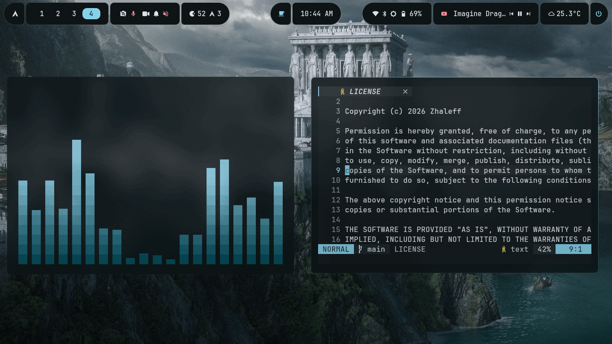
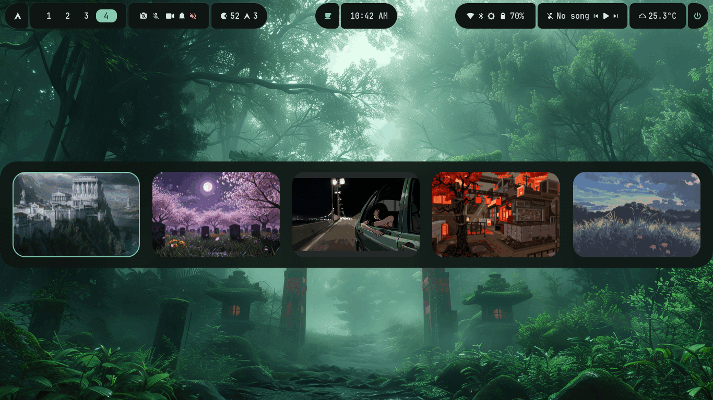
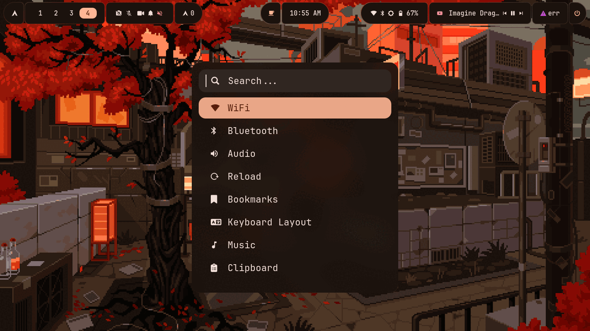
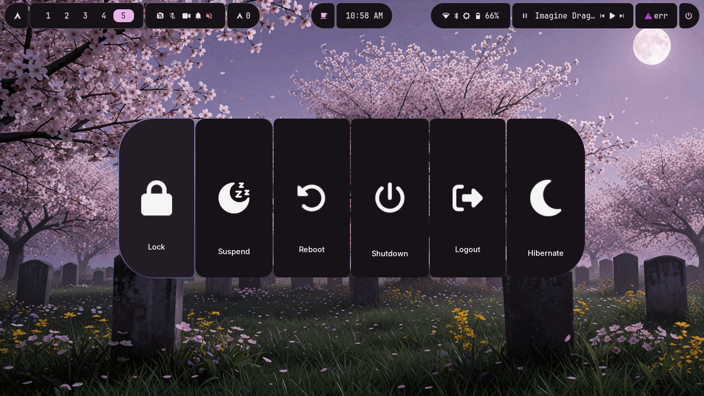
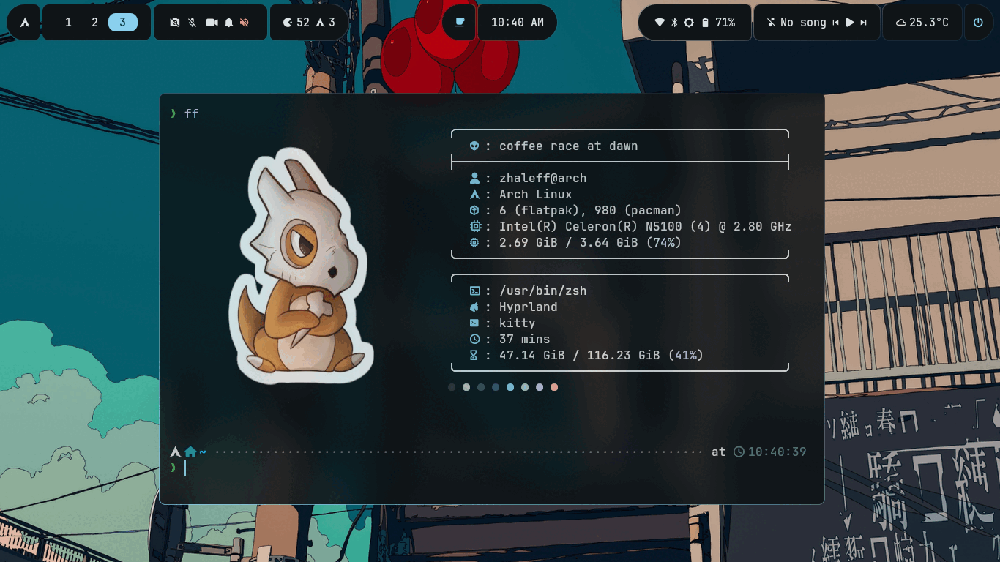
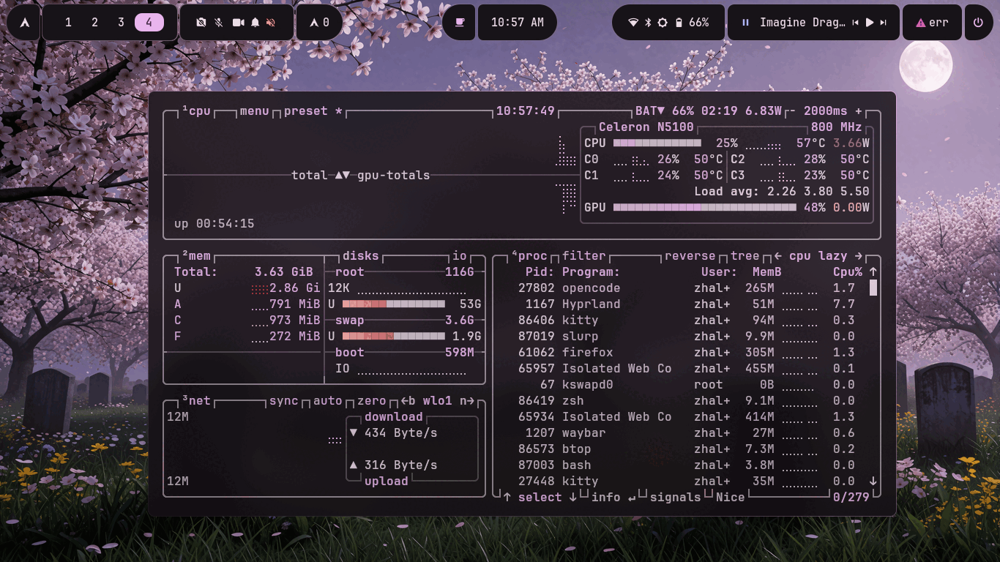
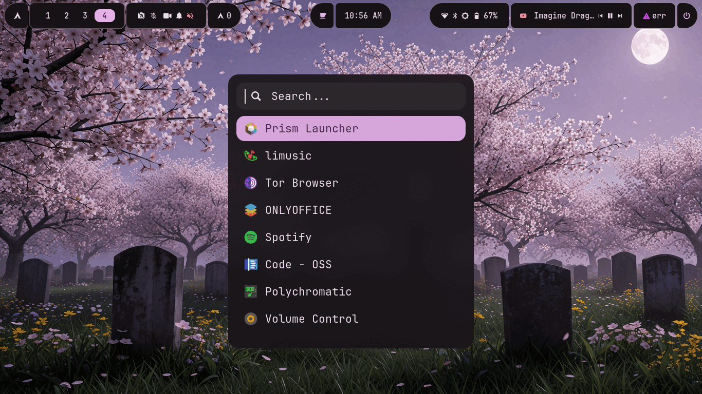
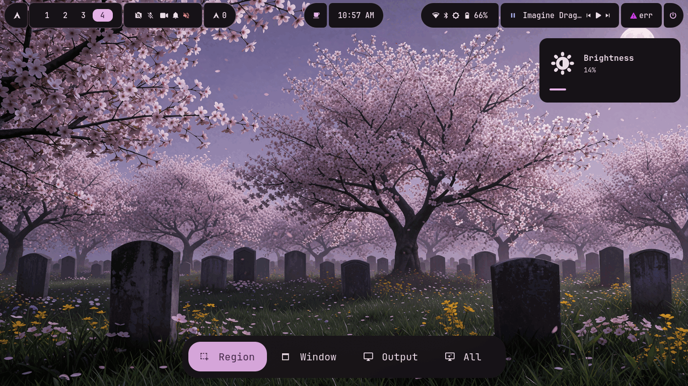

<h1 align="center">BlackNode</h1>

<div align="center">

<a href="https://github.com/zhaleff/BlackNode/stargazers"></a>&nbsp;&nbsp;
<a href="https://github.com/zhaleff/BlackNode/forks"></a>&nbsp;&nbsp;
<a href="https://github.com/zhaleff/BlackNode/issues"></a>&nbsp;&nbsp;
<a href="https://github.com/zhaleff/BlackNode/commits/main"></a>&nbsp;&nbsp;
<a href="https://github.com/zhaleff/BlackNode/blob/main/LICENSE"></a>&nbsp;&nbsp;

</div>

<div align="center">
  <h3>A dark Hyprland desktop that follows the wallpaper.</h3>
  <p>Built for late hours, fast hands, and fewer interruptions.</p>
</div>

#

<div align="center">

<a href="#the-feel"><kbd> <br> The feel <br> </kbd></a>&ensp;&ensp;
<a href="#installation"><kbd> <br> Installation <br> </kbd></a>&ensp;&ensp;
<a href="#what-you-get"><kbd> <br> What you get <br> </kbd></a>&ensp;&ensp;
<a href="#documentation"><kbd> <br> Documentation <br> </kbd></a>&ensp;&ensp;

</div>

#

<div align="center">
  
  <br>
  <sub><i>Cava and Neovim, colored from the same wallpaper.</i></sub>
</div>

You log in at night. The room is dark, the screen is darker, and the desktop is already quiet: near-black surfaces, soft borders, and a single set of accent colors pulled from the image on the wall.

That image is the theme. Pick a new wallpaper and BlackNode repaints the bar, terminal, notifications, lock screen, and editor to match it. There is no theme menu to open and no palette to assemble by hand. The desktop changes because the room changed.

BlackNode is a complete Hyprland setup for Arch Linux. It ships with a grouped Waybar, a Rofi control menu, a scrolling window layout, a lock screen, and scripts for the small things you reach for every day. The files are plain text, linked into your home, and meant to be edited.

## The feel

### The wallpaper is the theme

`matugen` reads the image and extracts a Material You palette from it. The bar, Kitty, Dunst, Rofi, Hyprlock, and Neovim receive that palette in their own formats. Choose a warm sunset and the desktop warms up. Choose a cold photograph and the edges turn blue.

Most of the desktop follows. A few pieces keep their own character: Yazi stays on Catppuccin Mocha, Fastfetch stays blue, and Clipse keeps its gold theme. The result is a room with a few objects that do not match, on purpose.

<div align="center">
  
  <br>
  <sub><i>The wallpaper picker. Choose an image; the desktop follows.</i></sub>
</div>

### Your hands stay on the keys

`SUPER` is the main modifier. The same four keys, `h`, `j`, `k`, and `l`, focus, move, resize, and drag depending on what you hold with them. Workspaces run from 1 to 9. `TAB` takes you back to the last one. The mouse works, but it is the slower path.

The layout is `scrolling`, not classic tiling. Windows arrive as columns. You move the columns with `SUPER + .` and `SUPER + ,`, and the desktop keeps its shape while you work.

<div align="center">
  
  <br>
  <sub><i>The control menu, one <code>SUPER + SPACE</code> away.</i></sub>
</div>

### The session knows when to stop

At five minutes the brightness drops. At seven the screen locks. At eight the display turns off. At fifteen the machine suspends. The sequence lives in `hypridle.conf`, and it is one of the few things BlackNode does without asking.

<div align="center">
  
  <br>
  <sub><i>The session menu, ready when the night ends.</i></sub>
</div>

## Installation

BlackNode targets a minimal [Arch Linux](https://wiki.archlinux.org/title/Arch_Linux) install. The installer links the configs, backs up what it replaces, and asks before it touches the system.

> [!IMPORTANT]
> The installer overwrites your GTK, Qt, shell, and Zsh configuration. It backs up existing files, but review what it will replace before you continue.

```bash
git clone https://github.com/zhaleff/BlackNode.git "$HOME/BlackNode"
cd "$HOME/BlackNode"
bash Scripts/install.sh
```

When it finishes, log out and back in. Then press `SUPER + W` and choose an image. That first choice generates the colors the rest of the desktop is waiting for.

> [!NOTE]
> The installer does not run `matugen`. Until you pick a wallpaper, Hyprland, Waybar, Kitty, Dunst, and Hyprlock may look for generated files that do not exist. [docs/firstBoot.md](./docs/firstBoot.md) walks through the first login.

## What you get

- A grouped Waybar with workspace, network, volume, battery, media, weather, and package modules.
- A Rofi menu for WiFi, Bluetooth, audio, screenshots, recording, wallpaper, clipboard, music, and session actions.
- A Hyprland configuration written in Lua, with one keybind grammar across focus, movement, and resizing.
- A lock screen with the clock, date, current track, and weather.
- A terminal, editor, file manager, notification daemon, and clipboard history that already share the same visual language.
- An installer that backs up your old configs and logs every command it runs.

## A closer look

<div align="center">
<table>
  <tr>
    <td align="center"></td>
    <td align="center"></td>
  </tr>
  <tr>
    <td align="center"><sub><i>Fastfetch, with a random image from the assets folder.</i></sub></td>
    <td align="center"><sub><i>btop, wearing the generated palette.</i></sub></td>
  </tr>
  <tr>
    <td align="center"></td>
    <td align="center"></td>
  </tr>
  <tr>
    <td align="center"><sub><i>The application launcher, one <code>SUPER + R</code> away.</i></sub></td>
    <td align="center"><sub><i>Screenshots without leaving the keyboard.</i></sub></td>
  </tr>
</table>
</div>

## Under the hood

Hyprland, Waybar, Kitty, Zsh with Powerlevel10k, Rofi, Dunst, Hyprlock and Hypridle, Yazi, Neovim, Matugen, awww, Cava, Wlogout, and Fastfetch.

## Documentation

The manual covers the parts that are easy to miss: generated files, the `~/BlackNode` path contract, the missing packages, and the places where the repo and the running system disagree.

| Document | What it covers |
|---|---|
| [Philosophy](./docs/philosophy.md) | The idea behind the desktop, the keyboard grammar, and the limits |
| [Anatomy](./docs/anatomy.md) | The repo layout, symlinks, installer flow, generated files, and state |
| [First boot](./docs/firstBoot.md) | From a clean clone to a working session, including the generated theme |
| [Aesthetics](./docs/aesthetics.md) | Matugen, color roles, geometry, typography, and Waybar styling |
| [Desktop](./docs/desktop.md) | Hyprland Lua, keybinds, scrolling layout, rules, idle, and locking |
| [Daily use](./docs/dailyUse.md) | The menu, Waybar modules, notifications, weather, shell, editor, and files |
| [Loose ends](./docs/looseEnds.md) | What is incomplete, mismatched, or likely to break |

## License

BlackNode is released under the [MIT License](./LICENSE). You are free to use, modify, and share it. Attribution is appreciated but not required.

#

<div align="center">
  <p>Made by <a href="https://github.com/zhaleff">zhaleff</a></p>
  <p><i>Pick a wallpaper. Let the desktop follow.</i></p>
</div>
